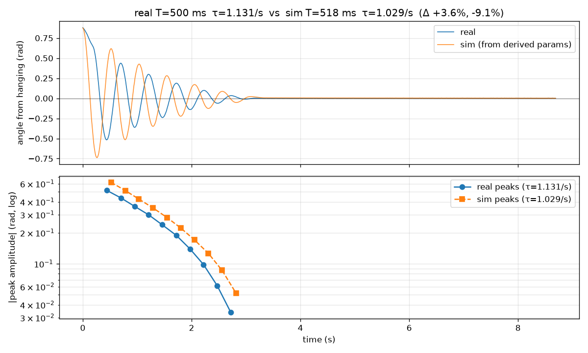
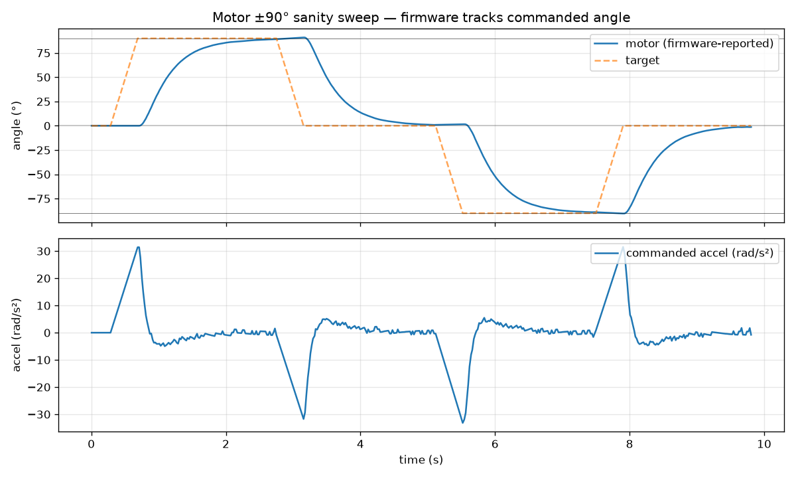

# Step 0：系統識別

<div class="rip-meta" markdown>
  <span class="rip-chip rip-chip--cyan">:material-clock-outline: 約 15 分鐘</span>
  <span class="rip-chip rip-chip--amber">:material-robot-industrial: 需要機台</span>
  <span class="rip-chip">:material-chip: LowLevelServer</span>
  <span class="rip-chip">:material-file-outline: 產出 sysid_params.json</span>
</div>

這一步把模擬釘在你那台機台上：量出擺錘鉸鏈的黏滯與庫倫摩擦，寫成 `sysid_params.json`。質量、質心、轉動慣量是零件的幾何性質，直接從 URDF 讀，**不在這一步量**。

<span id="level"></span>

!!! info "開始前：機台放在水平的桌面上"

    課程的機台已經調平，而且很穩，不需要另外測。你只要確認桌面本身是水平、堅固、不會晃的，機台四角都著地，量測開始後不要再移動。桌面不平請自己換一張桌子。

## 0-1 擺錘配重與幾何：要量什麼？ { #geometry }

結論：**不用秤手臂、也不用秤擺錘；要確認的是硬幣貼在正確位置而且貼牢，然後讓 sysid 的自由擺去驗證。**

<div class="grid cards" markdown>

-   :material-arm-flex:{ .lg .middle } **手臂質量不影響模型**

    ---

    模擬裡手臂由步進馬達以剛性位置控制驅動，它的質量不進入擺錘的運動方程式，只影響馬達會不會失步，而這在上電測試（`03_check_motor`）已驗過。手臂要對的是長度，由零件設計決定，列印不會改變。

-   :material-printer-3d:{ .lg .middle } **列印質量差異幾乎不影響**

    ---

    模擬真正需要的是 m·d/I（決定自然頻率）與摩擦。列印密度從 0.6 到 1.24 g/cm³，自然頻率只在 12.41–12.51 rad/s 之間（±0.4%），因為 7.5 g 的硬幣佔了一半以上的質量。

-   :material-target:{ .lg .middle } **真正會影響的是硬幣位置**

    ---

    硬幣沿擺杆偏 3 mm，自然頻率就變約 1.6%，是列印差異的 4 倍。照[貼上配重硬幣](../prepare/hardware.md#coin)的方式貼，誤差控制在 ±1 mm。

-   :material-check-decagram:{ .lg .middle } **怎麼檢查**

    ---

    用手搖搖看硬幣不會鬆動；sysid 後小振幅自然頻率應在 12.3–12.6 rad/s（週期約 0.50–0.51 s），慣量誤差 < 10%。選做：秤擺錘總重（含硬幣），預期約 14–15 g。

</div>

## 0-2 跑 sysid 精靈 { #wizard }

!!! tool "操作步驟"

    1. 用 Arduino IDE 上傳 `LowLevelServer`（與微調時同一份韌體，量測與部署不會對不上），關掉序列埠監控。
    2. 準備一塊硬紙板或泡棉塊。
    3. 執行 `tools/05_sysid`。
    4. 選單出現時輸入 `1`（新量測），或直接按 Enter。
    5. 照畫面依序做下面四件事。

精靈會帶你做：

1. **標定垂下位置**：**先不要放墊塊**，讓擺錘自然垂到最低點、完全靜止，再按 Enter。精靈錄 3 秒，取中位數當 0。墊塊是下一步自由擺才用。標定位置跟擺錘停下的位置差超過 10°，擬合時工具會提醒你（擬合結果不受影響）。
2. **自由擺動 × 3**：手壓住手臂，用塊子把擺錘墊高，再從垂直於擺動平面的方向抽出。每次錄 10 秒。
3. **馬達 ±90° 掃描**：手臂走 0 → +90° → 0 → −90° → 0。**12 V 要接著**。目視確認手臂真的轉到左右約 90°（跟底座垂直）再回到正中間，明顯不足就是失步。
4. **擬合與畫圖**：寫出 json，並在 `sysid_runs/<時間>/` 產生 `freeswing_compare.png` 與 `motor_sweep.png`。

精靈的掃描只用到約 40 rad/s²，策略則會用到 150 rad/s²；高加速度下不失步已在上電測試用 `03_check_motor` 驗過。

??? cmd "背後執行的指令"

    ```bash
    cd policy
    uv run python sysid_wizard.py --port <PORT> --out-json sysid_params.json
    ```

## 檢查點 { #checkpoint }

!!! checkpoint "全部符合才進 Step 1"

    | 項目 | 通過條件 |
    | --- | --- |
    | `freeswing_compare.png` | 模擬與實測的振幅包絡線幾乎重疊 |
    | 小振幅自然頻率 ω~n~ | 工具採用的那次（三次的中位數，寫進 `sysid_params.json`）在 12.3–12.6 rad/s（週期約 0.50–0.51 s），而且三次的最大與最小相差 < 3%（約 0.4 rad/s）。只有一次偏掉、另外兩次彼此接近又都在範圍內也算通過：工具用中位數，偏掉的那次不影響結果，多半是放手時碰到或有震動 |
    | 轉動慣量：量測 vs URDF 預測 | 誤差 < 10% |
    | 馬達掃描（**目視**） | 手臂真的轉到左右約 90° 再回到正中間。`motor_sweep.png` 的藍線是韌體的步數計數，12 V 沒接、手臂沒動也會畫得很漂亮，所以不能只看圖 |
    | 馬達聲音 | 平順，不嘶嘶不磨 |

### 兩張圖怎麼看 { #plots }

<figure class="rip-figure" markdown>

<figcaption><code>freeswing_compare.png</code> 正常的樣子（課程機台實測）</figcaption>
</figure>

- **上圖**：藍色（實測）和橘色（模擬）都是衰減的正弦波，y 軸大約在 ±1 rad 內。一開始的相位可能差一點（放手時手的干擾），不影響。
- **下圖**：兩條峰值線是往下的斜線，彼此靠近。
- **標題的 Δ**：第一個是週期差，應在約 ±5% 內；第二個是衰減差，±20% 內都算正常。
- **壞掉的樣子**：y 軸到幾百、幾千 rad，或下圖是空的。這是工具的問題，不是你的量測，找助教。

<figure class="rip-figure" markdown>

<figcaption><code>motor_sweep.png</code>：藍線（韌體計數）落後目標約 0.5 秒是正常的</figcaption>
</figure>

- 藍線會落後橘色虛線約 0.5 秒才到位，這是正常的（精靈只用約 30–40 rad/s²）。
- 要看藍線最後有沒有到 ±90° 的細黑線、回到 0°。
- **這張圖不能證明手臂真的動了**（見上面檢查點的「目視」那一列）。

### 檢查點沒過時 { #checkpoint-fail }

<ol class="rip-ol">
<li><b>只有「自由擺擬合」不好</b>（包絡線不重疊，或三次 ω<sub>n</sub> 相差 ≥ 3% 而且不只一次偏掉）：再執行 <code>tools/05_sysid</code>，選單輸入 <code>1</code>（新量測），整套重做一次，約 15 分鐘。</li>
<li><b>想用同一份錄製重新擬合</b>（例如助教更新了擬合程式）：執行 <code>tools/05_sysid</code>，選單輸入 <code>2</code>（用已存的錄製重新擬合），再從列出的 <code>sysid_runs/&lt;時間&gt;</code> 裡選一個，不用碰機台。</li>
<li><b>慣量誤差超過 10%</b>：先檢查硬幣位置與是否鬆動（<a href="../../prepare/hardware/#coin">貼上配重硬幣</a>），修好後照第 1 點重量。仍然超過就找助教。</li>
</ol>

??? cmd "第 2 點背後執行的指令"

    ```bash
    cd policy
    uv run python sysid_wizard.py fit --in-dir sysid_runs/<時間> --out-json sysid_params.json
    ```

!!! warning "機構改過就要重量"

    換軸承、重裝擺臂或擺錘、重貼硬幣，都要照第 1 點重量，而且後面的 Step 1–4 都要重做。
